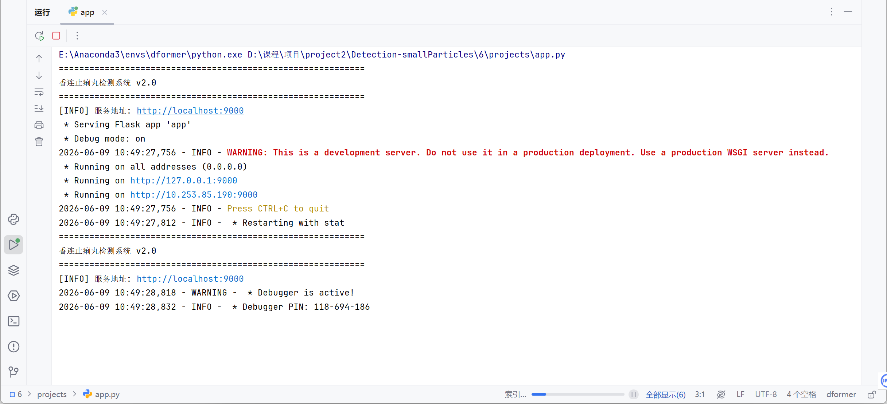
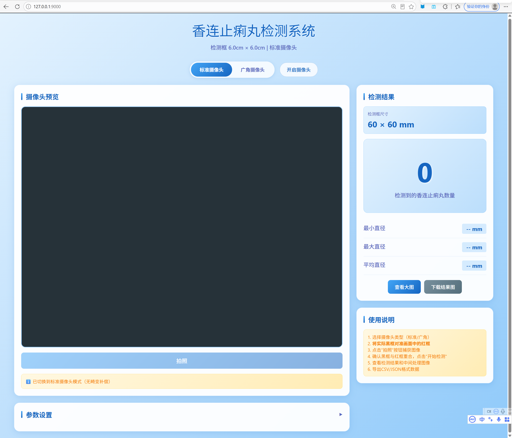

# 智能颗粒检测系统（Detection-smallParticles）

> 面向药品颗粒与农业种子质检的工业视觉检测系统 · 独立开发 / 参赛项目


针对药品颗粒与农业种子质检场景开发的智能视觉检测系统，支持实时检测、参数调优与数据导出。

## 项目预览

### 后端检测服务


### 前端交互界面


## 核心能力

- **四边形检测 + 透视校正**：基于 OpenCV 的多策略四边形检测，配合透视变换（Perspective Transform）校正拍摄畸变，保证尺度一致。
- **自适应阈值分割**：采用 Otsu 与直方图分析，对光照不均的样本实现稳定分割。
- **圆形度滤波**：引入圆形度公式 `4π × 面积 / 周长²` 过滤非颗粒噪点，提升计数与质检准确率。
- **Web 实时平台**：Flask 搭建交互界面，支持实时检测、参数在线调优、结果导出（CSV / JSON）。

## 技术栈

`Python` · `OpenCV` · `NumPy` · `Flask` · 图像处理算法

## 检测流程

```
图像采集 → 预处理(去噪/增强) → 四边形检测 + 透视校正
        → Otsu 自适应分割 → 轮廓提取 → 圆形度滤波
        → 颗粒计数 / 质检判定 → 结果可视化 + CSV/JSON 导出
```

## 输出

- 实时检测可视化界面
- 颗粒统计与质检结果
- 数据导出：CSV / JSON

## License

[MIT](LICENSE)
